# TP2 Cybersécurité
- Nom: (Lucresse Jouonang Kwagwe)
- Matricule: (6301154)
- Groupe: (1010)

## Attaque (exploit)

Voici les étapes détaillées pour pouvoir modifier le courriel / téléphone sur la page demandée:

### Étape 1 : Repérage des ports ouverts avec Nmap

 **Commande utilisée :** Aucune j'ai juste ouvert l'application 
 **Objectif et effet :** Scanner la machine cible depuis le poste Windows afin d'identifier les services actifs et les ports TCP ouverts à distance. Le scan a permis de découvrir que le service HTTP (port 80) et le service SSH (port 22) étaient ouverts et accessibles.
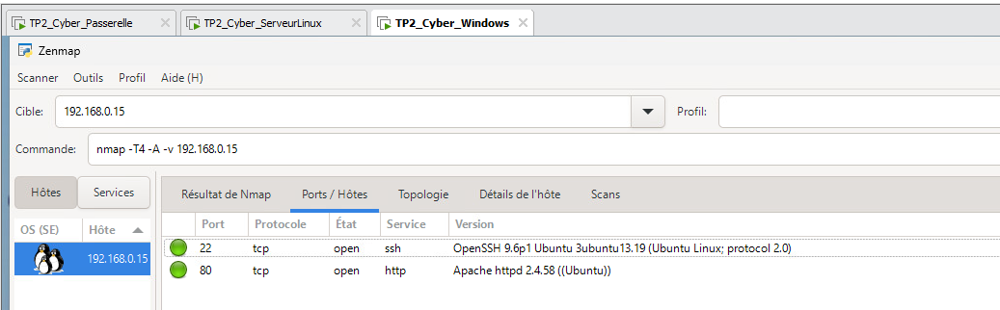

### Étape 2 : Authentification distante via SSH (Réutilisation de mot de passe)

 **Commande utilisée** : `ssh bob@192.168.0.15`
 **Objectif et effet** : Tenter une connexion à distance sur le serveur Linux en utilisant les informations collectées . À partir des prénoms et années de naissance des enfants de Bob, le mot de passe `Sophie2014!` m'a permis de valider l'authentification SSH et d'obtenir un accès à distance sur la machine de bob.

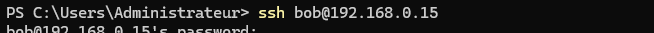 et j'ai pu me connecter  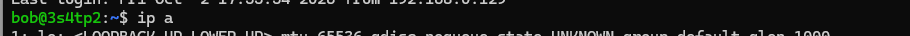

### Étape 3 : Exploration du répertoire Web

 **Commandes utilisées :** `cd /var/www/html` et `ls -la`
  **Objectif et effet** : Se déplacer dans le répertoire racine du serveur Web Apache (/var/www/html) pour lister le contenu et repérer la structure des fichiers de l'application Web. La commande a révélé la présence du fichier contact.html.

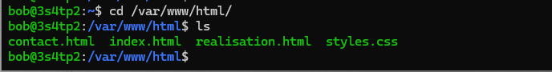

### Étape 4 : Altération de la page de contact 

**Commande utilisée** : `nano contact.html`
**Objectif et effet** : Ouvrir le fichier de la page de contact pour y apporter les modifications requises. Le numéro de téléphone de l'entreprise a été remplacé par 555-555-9876 et le courriel de contact client a été remplacé par ouch.hacked@cem.ca. Les modifications ont ensuite été enregistrées
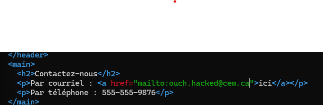

## Correctif 1 : Modification des permissions du dossier Web

Pour empêcher qu'un utilisateur standard puisse modifier les fichiers du site, j'ai changé les permissions et le propriétaire du dossier /var/www/html directement en me connectant avec le compte administrateur (DaBoss).

**Commandes utilisées** :  

`sudo chown -R root:root /var/www/html` : Change le propriétaire et le groupe de tout le dossier du site web pour les mettre à root (l'administrateur plus haut ). L'utilisateur normal (Bob) perd ainsi la propriété des fichiers.

`sudo chmod -R 755 /var/www/html` : Modifie les permissions pour que seul root puisse modifier ou écrire dans le dossier, tandis que les autres utilisateurs (et le serveur web) ont uniquement le droit de lire et d'afficher le site.
Résultat plus claire des permissions avec la commande ls -l : 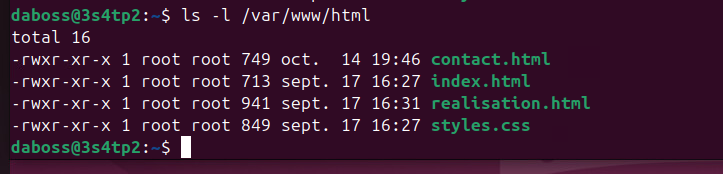

Capture d'écran de l'exploit qui ne fonctionne plus :
Lorsque j'essaie de modifier le fichier de contact avec le compte de Bob, le système refuse l'accès et affiche une erreur de permission lors de la sauvegerde : 
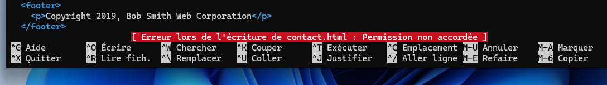

**Étape de l'exploit brisée** : Ce correctif bloque directement l'étape de la modification du fichier contact.html (l'étape 4 de l'attaque).

## Correctif 2 : Changement du mot de passe de Bob 

Pour empêcher qu'un attaquant puisse se connecter avec un mot de passe qui a fuité sur le dark web j'ai modifier le mot de passe de bob avec un mot de passe plus fort 

**Commandes utilisées** :  

sudo passwd bob : Permet à l'administrateur de réinitialiser et de remplacer l'ancien mot de passe faible de Bob par un nouveau mot de passe fort et totalement inconnu de l'attaquant. 
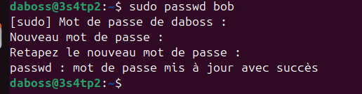

Capture d'écran de l'exploit qui ne fonctionne plus : 
Pas besoin, car un mot de passe doit rester confidentiel et ne doit pas être connu de tous .

**Étape de l'exploit brisée** : Ce correctif bloque l'étape 2 (Connexion SSH). L'attaquant ne peut plus utiliser l'ancien mot de passe fuité (Sophie2014!) pour se connecter.

## Correctif 3 : Installation et configuration d'un pare-feu (UFW)

J'ai configuré le pare-feu de la machine pour bloquer les connexions non désirées tout en laissant passer le trafic web.

**Commandes utilisées** : 
`sudo ufw default deny incoming` : pour bloquer par défaut toutes les connexions entrantes venant de l'extérieur.
`sudo ufw default allow outgoing` : pour laisser la machine communiquer librement vers l'extérieur (pour aller sur Internet, faire des mises à jour, etc.).
`sudo ufw allow 80/tcp` : Autorise uniquement le trafic Web (port 80) pour que les clients puissent voir le site.
`sudo ufw enable` : Active officiellement le pare-feu pour appliquer toutes ces règles.
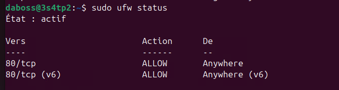
**Capture d'écran de l'exploit qui ne fonctionne plus** : 
* Lorsque j'essaie de me connecter en ssh: 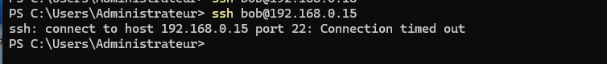
* Lorsque j'essaie le balayage avec nmap c'est juste le port 80 qui est ouvert : 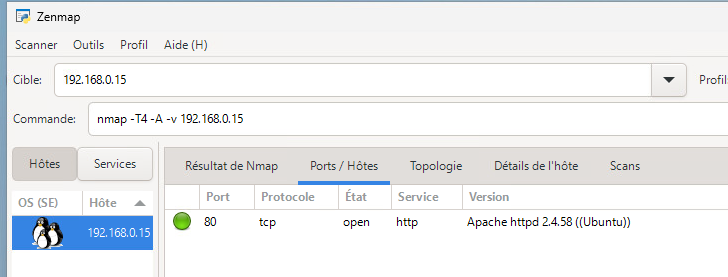

**Étape de l'exploit brisée** : Ce correctif bloque l'étape du scan et de l'accès réseau (les étapes 1 et 2), car les ports non nécessaires sont fermés depuis l'extérieur.